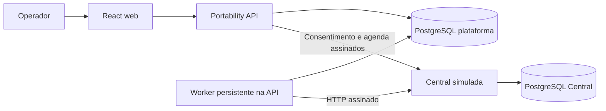
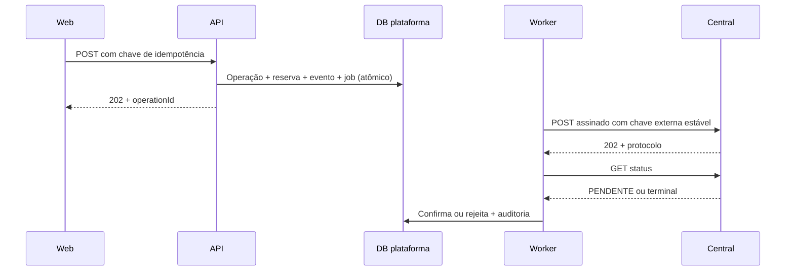

# Visão geral da arquitetura

**Documento balizador:** [system-design.md](system-design.md) — abra o Miro pelo [frame 00 · Mapa de navegação](https://miro.com/app/board/uXjVEJ1cEDw=/?share_link_id=843643210573&moveToWidget=3458764691629361954).

Este overview é o resumo executável no repositório; decisões devem rastrear o Miro. Idioma: português (termos técnicos: C4, HMAC, etc.).

Módulos: consentimento, agenda, portabilidade, liquidação, auditoria; integração e shared são suporte. Empacotar por feature; domínio/aplicação/adaptadores só onde necessário. Sem acesso cruzado direto à persistência entre módulos. Liquidação pode permanecer dentro de portabilidade enquanto não houver ciclo de vida independente.

## Fronteiras

- A UI só fala com a API da plataforma.
- A Central é um processo e um banco separados.
- Autorização e agenda entram pela API da plataforma (HMAC para a Central).
- O worker envia e consulta portabilidades; a UI nunca chama a Central.

## Decisões que exigem ADR

- Bancos separados para plataforma e Central.
- Jobs persistentes no PostgreSQL (sem broker no lab).
- Polling do status na Central (sem webhook no contrato do desafio).
- Conta efetiva só muda após confirmação verificada.
