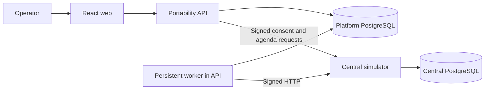
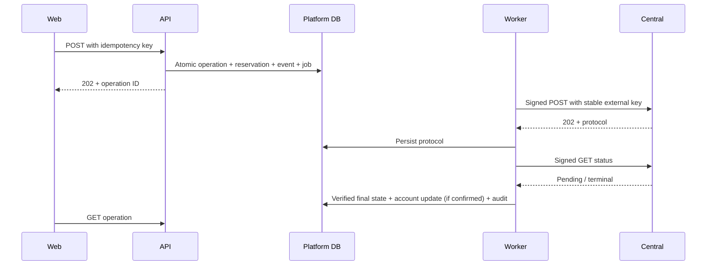

# Proposed architecture

**Documento balizador:** [system-design.md](system-design.md) (board Miro de system design). Este overview é o resumo executável no repositório; decisões de arquitetura devem rastrear o Miro.

Modules: consent, schedule, portability, settlement, audit; integration and shared are supporting packages. Package by feature, domain/application/adapters inside each feature only as needed. No direct cross-module persistence access. Settlement can initially remain within portability if no independent lifecycle exists.

Business states: PENDENTE → CONFIRMADA or REJEITADA; technical job status independent. A timeout is not rejection. On rejection release reservation; on confirmation mark installment ported; ambiguous outcomes retain reservation for reconciliation. Central owns authoritative receiving-account change; platform mirrors confirmed outcome. Proposed all-or-nothing operation semantics must be documented and tested.

Data: beneficiaries, consents, installment snapshots, operations, operation_installments, operation_events, idempotency_keys, processing_jobs. Central owns separate records. Use unique active reservation per external installment, unique protocol, scoped idempotency key, event sequence per operation. Worker fencing prevents stale lease owners committing results.

Threats: replay, tampering, duplicate submissions, IDOR, secret leakage, simulator controls exposed, ambiguous remote outcome. Mitigations in SPEC-005/006/008 and security skill. HMAC is not operator authentication or TLS.
