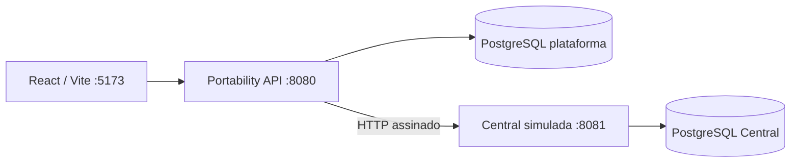

# System design (documento balizador)

**Author:** Douglas Morais  
**Idioma desta documentação:** português (termos técnicos inevitáveis em inglês: C4, HMAC, SLO, OpenTelemetry).

**Comece pelo índice do Miro (frame 00):**  
[00 · Mapa de navegação — Case Cielo](https://miro.com/app/board/uXjVEJ1cEDw=/?share_link_id=843643210573&moveToWidget=3458764691629361954)

O board Miro é a **fonte autoritativa** das decisões de arquitetura. Specs (`docs/specs/`), ADRs (`docs/adr/`), OpenAPI e código devem permanecer alinhados a ele. Em divergência: tratar o Miro como intenção de design e registrar a resolução (ADR + sessão AI + revisão humana).

Este arquivo é o **índice versionado no Git**; diagramas detalhados e teses de defesa vivem no Miro.

## Como o avaliador deve navegar

1. Abrir o link do **frame 00** (mapa).
2. Percorrer **01–20** (fundamentos + defesa).
3. Conferir **21–23** (como está implementado hoje).
4. Tratar **24–32** como propostas produtivas — **não** estão implantadas no lab.

Legenda do mapa: azul = fundamentos/defesa · verde = as-is · âmbar = to-be.

## Índice completo do board (00–32)

| # | Frame | Tema |
|---|---|---|
| **00** | **Mapa de navegação — Case Cielo** | **Entrada obrigatória** |
| 01 | Contexto de negócio e requisitos | Escopo, RF/RNF, dados sintéticos |
| 02 | Contexto do sistema · C4 L1 | Plataforma vs Central |
| 03 | Arquitetura de containers · C4 L2 | Web, API, Central, 2× PostgreSQL |
| 04 | Arquitetura de componentes · C4 L3 | Domínio independente de framework |
| 05 | Arquitetura de domínio · DDD | Bounded contexts / módulos |
| 06 | Arquitetura de dados · ERD | Reservas, idempotência, eventos — [data-model.md](data-model.md) |
| 07 | Ciclo de vida da portabilidade | Opt-in → 202 → worker → protocolo → status |
| 08 | Idempotência e concorrência | Chave + hash; 409; reserva única |
| 09 | Processamento assíncrono e recuperação | Timeout/503 ≠ rejeição; lease |
| 10 | Máquina de estados da operação | PENDENTE → CONFIRMADA / REJEITADA |
| 11 | Arquitetura de segurança | HMAC, segredos, mascaramento |
| 12 | Observabilidade e confiabilidade | Logs, traces, métricas |
| 13 | Infraestrutura e DevSecOps | Compose, CI (lab, sem alegação produtiva) |
| 14 | Harness de engenharia com IA | Skills, evidência, aprovação humana |
| 15 | Decisões arquiteturais e trade-offs | Monólito, jobs no DB, polling |
| 16 | Teses e defesa: arquitetura | Jobs duráveis + polling |
| 17 | Teses e defesa: consistência | Timeout não prova falha financeira |
| 18 | Atributos de qualidade | Segurança, manutenibilidade |
| 19 | Atributos de qualidade operacionais | Disponibilidade e resiliência |
| 20 | Roteiro de defesa técnica | Narrativa de avaliação |
| 21 | System Design As-Is | Visão da implementação entregue |
| 22 | Sequência: fluxo de portabilidade | Sequência principal |
| 23 | Sequência: recuperação após timeout | Recuperação |
| 24 | AWS: arquitetura de produção | Proposta (não implantada) |
| 25 | EKS e RDS | Proposta |
| 26 | OpenTelemetry e APM | Proposta (+ lab local com LGTM) |
| 27 | SLO, APM e incidentes | Proposta |
| 28 | Implantação AWS e GitOps | Proposta |
| 29 | Antifraude: motor de decisão | Proposta |
| 30 | Gaps de segurança e mitigação | Proposta |
| 31 | Threat model | Proposta |
| 32 | Disaster Recovery e reconciliação | Proposta |

## Decisões-chave (extraídas do Miro)

### Negócio e aceite (frame 01)

- Fluxo: opt-in → seleção de parcelas → registro → Central confirma/rejeita → conta só muda após confirmação.
- Funcionais: autorização, agenda, seleção, registro, status, auditoria.
- Não funcionais: HMAC, idempotência nos dois sistemas, polling, retry e falhas parciais.
- Restrições: Central simulada, dados sintéticos, README reproduzível; **sem integração bancária real**.

### Containers C4 L2 (frame 03)

- O navegador acessa **somente** a plataforma.
- Bancos separados; sem transação compartilhada.
- Stack do lab: Java 25, Spring Boot, JDBC, Flyway, React/Vite (Compose `:5173` HMR), Compose. Nginx only for Dockerfile `runtime` static image.

### Ciclo de vida (frame 07)

1. Opt-in + agenda  
2. POST local com chave estável  
3. Commit atômico de operação + reserva + evento + job  
4. Worker envia POST assinado à Central (**fora** da transação SQL)  
5. Central responde 202 + protocolo  
6. Poll de status → confirma/rejeita e audita  

### Idempotência e concorrência (frame 08)

- Chave estável + hash canônico; claim atômico / índice único.
- Mesmo payload → resposta original; payload diferente → **409**.
- Reserva ativa única por parcela.
- Após aceite com resposta perdida: reenviar chave de negócio com **novo nonce**.

### Trade-offs (frame 15)

| Escolha | Racional |
|---|---|
| Monólito modular + Central separada | Menos operação local; Central reproduz falhas de rede |
| Jobs no PostgreSQL (vs broker) | Agendamento atômico; broker só se métricas justificarem |
| Polling (vs webhooks) | Alinha ao contrato da Central |
| JDBC (vs ORM pesado) | Controle de invariantes financeiros |
| Auditoria append-only | Custo/PII menores no escopo do case |

### Harness de IA (frame 14)

- Spec → skill → implementação → testes reais → revisão independente → evidência → **aprovação humana**.
- Nunca inventar validações; distinguir PASS / FAIL / NOT_RUN.

## Mapeamento para o repositório

| Miro | Artefatos locais |
|---|---|
| 00 mapa | Este arquivo + README |
| 01 requisitos | [requirements-traceability.md](../requirements-traceability.md), `docs/specs/*` |
| 02–05 C4/DDD | [overview.md](overview.md), ADR-001/002 |
| 06 dados | ADR-003, [data-model.md](data-model.md), Flyway |
| 07–10 async/estado | SPEC-003/004/007/008, ADR-006/007/010/011 |
| 08 idempotência | SPEC-005, ADR-005 |
| 11 segurança | SPEC-006, ADR-009 |
| 12 observabilidade | ADR-014, [observability.md](observability.md) |
| 13 DevSecOps | `.github/workflows`, `docker-compose.yml` |
| 14 IA | `AGENTS.md`, `ai/sessions/*`, ADR-015 |
| 15 trade-offs | ADRs + README |
| 21–23 as-is | Código em `apps/*` |
| 24–32 to-be | Somente proposta no Miro |

## Governança

1. Mudanças em invariantes financeiros, de segurança ou de consistência devem citar o frame Miro na sessão AI e no ADR.
2. Atualizar este resumo quando o board mudar de forma material.
3. Links públicos de compartilhamento devem abrir no **frame 00**.
